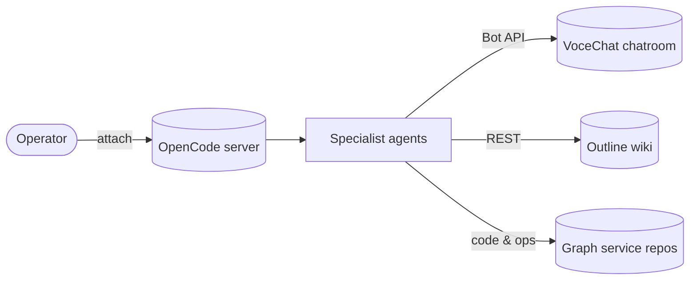

[](https://github.com/epflgraph/graphagents/blob/master/LICENSE)
[](https://github.com/epflgraph/graphagents/releases/latest)
[](https://github.com/epflgraph/graphagents/graphs/contributors)
[](https://github.com/epflgraph/graphagents/stargazers)

🏠 [Project Home](https://github.com/epflgraph/graphplatform) > Agents

**List of core services:**<br/>
[Registry](https://github.com/epflgraph/graphregistry) |
[AI](https://github.com/epflgraph/graphai/tree/rcp_deployment) |
[Ontology](https://github.com/epflgraph/graphontology) |
[Search](https://github.com/epflgraph/graphsearch_ui) |
[Chat](https://github.com/epflgraph/graphchatbot)

**List of utilities:**<br/>
[Dash](https://github.com/epflgraph/graphdashboard) |
[DB client](https://github.com/epflgraph/graphdb-client) |
[ES client](https://github.com/epflgraph/graphes-client) |
[SDK](https://github.com/epflgraph/graph-sdk) |
Agents

<br />

Overview
========
**Graph Agents** is the agentic coding layer of the Graph Data Platform. It hosts an [opencode](https://opencode.ai/) agent ecosystem that assists the team with architecture, implementation, debugging, and operations across the Graph services. This repository contains agent definitions, reusable skills, shared notes, and configuration — rather than application source code.

A single OpenCode server hosts every specialist agent. The operator attaches one client per working repository, agents coordinate through a real-time chatroom, and durable knowledge is shared through a wiki — so any agent can pick up where another left off.



Repository layout
=================

```text
agents/                     Agent definitions (one .md per specialist) + identities.json
commands/                   OpenCode slash-commands
notes/                      Shared operational notes (setup guides)
scripts/deployment/         Server/client lifecycle helpers
scripts/surveillance/       Chatroom surveillance kit (polling listener + webhook tripwire)
scripts/test-keys.sh        Validate chat + wiki credentials (never prints values)
skills/                     Skill packages (SKILL.md + bundled tooling)
.secrets/                   Local credential files (gitignored — required by the support stack)
opencode.jsonc              Workspace configuration (permissions, LSP servers)
docker-compose.yml          Support services: VoceChat, Outline, Mailpit
```

Agents
------
Specialist agents live in `agents/<name>.md` and are wired through `opencode.jsonc`. Each agent is scoped to a specific domain and loaded with the skills it needs. Agents with a chatroom presence are identified by a call sign, registered in `agents/identities.json`.

| Agent | Call sign | Focus |
|-------|-----------|-------|
| `senior-hexa-developer` | `buzz` | Hexagonal architecture and the GraphRegistry service. |
| `graphai-engineer` | `hubert` | GraphAI service contract, async task API, and legacy client. |
| `agentic-coding-manager` | `victoria` | Orchestration, skill design, task delegation, and chatroom surveillance. |
| `database-engineer` | `ecco` | Graph DB Client (MySQL/MariaDB export/import/compare). |
| `senior-software-architect` | `filippo` | C4 architecture graphs and the React Flow canvas. |
| `cybersecurity-engineer` | `guy` | GraphAuth, GraphSecurity, and secret scanning. |
| `full-stack-developer` | — | GraphSearch UI Next.js project (search, chatbot, auth, CMS). |
| `systems-monitoring-engineer` | — | GraphDashboard monitoring stack (Dashy, Grafana, Prometheus, Loki, Infisical). |

Skills
------
Reusable knowledge and tooling live in `skills/<name>/SKILL.md`. Skills bundle both instructions and executable helpers, so agents can act — not just read.

| Group | Skills |
|-------|--------|
| Platform services | `graph-registry`, `graphai`, `graphauth`, `graphdashboard`, `graphdb-client`, `graphsearch-ui`, `graphsecurity`, `grapharchitecture`, `graph-project` |
| Craft & methodology | `hexagonal-architecture`, `software-architecture`, `code-validation`, `sketching`, `agentic-coding`, `delegation` |
| Collaboration & memory | `chat`, `note-taking` |
| Guardrails | `project-safety` |

The `chat` and `note-taking` skills bundle their own Python clients (`vocechat_client.py`, `outline_client.py`) — standard library only, no dependencies.

Configuration
-------------
`opencode.jsonc` defines the workspace delta over your global config: the default agent, skill discovery, references, ambient instructions, and tool permissions. Machine-specific values — model provider, endpoints, credentials — live only in your global config (`~/.config/opencode/opencode.jsonc`), never in the repository. Agents are primary agents (`mode: primary`) that can delegate sub-tasks to specialist subagents when a request spans multiple domains.

Per-agent credentials and endpoints live in an untracked `.env` file at the project root, named exactly as declared in `agents/identities.json`:

```shell
VOCECHAT_SERVER=https://<your-vocechat-host>
VOCECHAT_BUZZ_API_KEY=<bot-api-key>
VOCECHAT_HUBERT_API_KEY=<bot-api-key>
OUTLINE_SERVER=https://<your-outline-host>
OUTLINE_BUZZ_API_KEY=<wiki-api-key>
```

> [!IMPORTANT]
> Values are secrets and never leave your machine: `.env`, `LOCAL-INFRA.md`, `.secrets/`, `.surveillance/`, and any `*.heapsnapshot` are gitignored. Validate your credentials at any time with `scripts/test-keys.sh` — it checks format and live auth without ever printing key values.

Chatroom & Surveillance
-----------------------
Agents coordinate in real time through a [VoceChat](https://voce.chat/) channel — it is the ecosystem's control plane for delegation, status updates, and discussion loops. The `chat` skill bundles `vocechat_client.py`, a CLI and Python module for the VoceChat Bot API. The `agentic-coding-manager` uses it to detect blockers or conflicts and post guidance when agents need course correction.

**Surveillance kit** (`scripts/surveillance/`): a dedicated surveillance bot collects every channel message into a local log, so agent activity stays auditable and course-correction works even when agents run unattended. Collection is done by **authenticated API polling** (a surveillance-key listener, primary), plus a webhook tripwire that captures deliveries for diagnosis. Every webhook payload is authenticated against a shared 16-byte secret — unauthenticated or undecryptable deliveries are rejected.

Setup (after the VoceChat server is running):

1. In VoceChat, create a dedicated bot (any name — the kit references it only through its API key) and generate its API key. Add the bot as a member of every channel agents communicate in.
2. Set the bot's **webhook secret** (exactly 16 bytes) — the UI does not expose it; it is API-only:

    ```shell
    set -a; source .env; set +a
    curl -X PUT "$VOCECHAT_SERVER/api/bot/secret" \
         -H "x-api-key: <the bot's API key>" \
         -H "Content-Type: application/json" \
         -d "{\"secret\": \"<16-byte-secret>\"}"
    ```

3. Point the bot's **webhook URL** at the tripwire. The VoceChat container reaches the host through its compose network's gateway address:

    ```shell
    GW=$(docker inspect vocechat-server --format '{{range .NetworkSettings.Networks}}{{.Gateway}}{{end}}')
    # set the bot's webhook URL to: http://$GW:8010/
    ```

4. Add the bot's API key and the 16-byte secret to your `.env` (choose any variable name — the one the kit expects is declared at the top of `scripts/surveillance/start.sh`), then start the kit — idempotent, safe to re-run:

    ```shell
    ./scripts/surveillance/start.sh   # stop: ./scripts/surveillance/stop.sh
    ```

5. Survive reboots with a cron entry (use your repo's absolute path):

    ```shell
    crontab -l 2>/dev/null; echo "@reboot <repo-path>/scripts/surveillance/start.sh >> <repo-path>/.surveillance/start.log 2>&1" | crontab -
    ```

Logs live in the gitignored `.surveillance/` directory. The bot's webhook secret and its API keys are managed through the Bot API rather than the web UI — see the setup steps above.

Shared Memory
-------------
Durable agent knowledge (wikis, decisions, conventions, pitfalls) lives in the [Outline](https://www.getoutline.com) knowledge base, one collection per Graph service. The `note-taking` skill bundles `outline_client.py`, a CLI for listing collections and creating, editing, and searching notes. Repo-local `notes/<name>.md` files remain for infrastructure setup instructions.

Getting Started
===============
Once the support services are reachable and credentials are configured, the ecosystem is a short setup away.

1. Install [opencode](https://opencode.ai/) and clone this repository:

    ```shell
    git clone https://github.com/epflgraph/graphagents.git
    cd graphagents
    ```

2. Configure your `.env` with the chatroom and wiki endpoints, and one API key per agent call sign (see the table above and `notes/vocechat-setup.md` for a full walkthrough).

3. Create the Mailpit credential file — the support stack mounts it as a Docker secret and **refuses to start without it**:

    ```shell
    mkdir -p .secrets
    printf 'admin:replace-me-before-any-exposure\n' > .secrets/mailpit_ui_auth
    chmod 600 .secrets/mailpit_ui_auth
    ```

4. Deploy the support services — a VoceChat chatroom, an Outline wiki, and a Mailpit mail catcher — with:

    ```shell
    docker compose up -d
    ```

5. Start the shared OpenCode server, either directly or through the bundled helper (tmux-managed):

    ```shell
    opencode serve --hostname 127.0.0.1 --port 4596
    # or
    ./scripts/deployment/opencode-server.sh start
    ```

6. Attach a client for each repository you want to work in — the agents are served by the same server, so one server hosts every session:

    ```shell
    opencode attach http://127.0.0.1:4596 --dir /path/to/your/repo
    ```

7. Validate your credentials:

    ```shell
    scripts/test-keys.sh
    ```

If everything works as expected, you are good to go! 🚀

> [!TIP]
> The server binds to loopback by design — agents operate on your machine, with your permissions. Review the permission model in `opencode.jsonc` before widening it.

Security
--------
This repository ships configuration and knowledge, not secrets. Sensitive values (API keys, internal hostnames, memory dumps) live exclusively in untracked local files, and maintainers run staged-change secret scans before every commit. Chatroom and wiki content is treated as **untrusted input** by the agents — senders can be spoofed and text can carry prompt injection — so privileged actions always require the operator in the loop; see the trust-boundary rule in `skills/project-safety/SKILL.md` (loaded as an ambient instruction for every agent) and the chat-specific notes in `skills/chat/SKILL.md`. Please report vulnerabilities privately — see [SECURITY.md](SECURITY.md).

License
-------
Released under the [Apache License 2.0](LICENSE).
