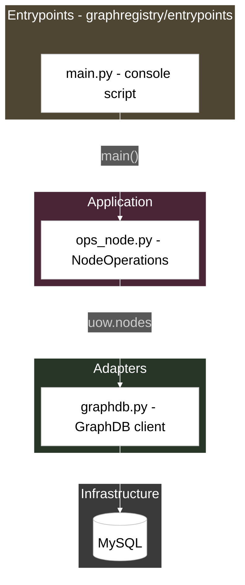

# Sketching

Mermaid house style for architecture "sketches": file/function flow diagrams used in wiki pages such as the GraphRegistry CLI command-flow docs. One box per file; function names ride on arrows as edge labels; layer subgraphs carry the tuned dark theme.

**All visual parameters live in `styles.json` in this skill's base directory — the single source of truth. Tuning the style is an edit to that JSON, never to this skill.**

This skill covers flowchart sketches (`layout.mode`). Sequence diagrams have no owner-approved style yet: if one is requested, reuse only the tested `theme` init-directive values and confirm any further styling with the owner before adding it.

## When to use

- Creating a diagram sketch for a wiki page: CLI command flows, sequences, architecture overviews.
- Editing or reviewing an existing mermaid sketch for style consistency.

## Renderer constraints (this Outline build)

- `flowchart-elk` (value of `layout.mode`) works and gives clean hierarchical placement.
- `{"defaultRenderer": "elk"}` inside a flowchart init is silently ignored (bundled Mermaid is pre-10.7) — do not use it.
- Init directives honored: `theme`, `themeVariables.background`, `themeVariables.fontSize`.

## Construction rules

Read `styles.json` first and substitute its values wherever a placeholder with a key path appears below.

Structure rules:

1. First line of the mermaid block: the init directive built from `theme`:
   `%%{init: {"theme": "<theme.name>", "themeVariables": {"background": "<theme.background>", "fontSize": "<theme.fontSize>"}}}%%`
2. Diagram type: `<layout.mode> <layout.direction>` (currently `flowchart-elk TD`).
3. One box per file (or coherent artifact), labeled `ID["filename.py - one-line role"]`. A ` ` inside the label is allowed for two-line box titles (used in the worked example).
4. Function names on arrows as quoted edge labels, in execution order: `A -->|"fn() then fn2()"| B`.
5. Subgraphs group layers (entrypoints, support/common, application incl. ports, domain, adapters, infrastructure). Give each a short id (EP, APP, DOM, ADPT, ...) and a title naming the package path.
6. Subgraph style: fill from the matching `layers.<name>` entry; unmapped groups use `layers.others`; stroke `layers.stroke`; label text `layers.labelColor`.
7. Edge order is **spine-first** (`structure.spineFirst`): declare the main vertical path (entrypoint down to the database) before branches so ELK centers it; branches (mappers, ports, secondary ops) hang off afterwards.
8. Dashed arrows `-.->` express "implements port" from adapters back to application ports (`structure.portArrowsDashed`).
9. `classDef`, `class`, `style`, and `linkStyle` statements go at the **end** of the mermaid block (all owner-tested diagrams do this — keeps renders and diffs consistent). Every node shares the single `box` class in one `class` statement; each subgraph gets one `style` statement.

Visual rules (values from styles.json):

- Boxes: `classDef box fill:<boxes.fill>,stroke:<boxes.stroke>,color:<boxes.text>;`
- Arrows: `linkStyle default stroke:<arrows.color>,color:<arrows.color>`
- Layer containers: `style <SUBGRAPH-ID> fill:<layers.<name>>,stroke:<layers.stroke>,color:<layers.labelColor>`

## Template

Each subgraph id maps 1:1 to a `layers` entry: EP→`layers.entrypoints`, APP→`layers.application`, ADPT→`layers.adapters`, INFRA→`layers.others`. Keep that consistency in every sketch: the subgraph id, the layer it groups, and the fill it receives must agree. A datastore node uses the cylinder shape: `DB[("MySQL")]`.

## Worked example

The full worked example (data command, 19 nodes / 6 subgraphs) lives in the Outline **Registry** collection: "GraphRegistry CLI command flows - steps, functions & files". The spec note "Sketching house style - spec for the sketching skill" is the fallback reference if test pages get archived.

## Safety

- Never invent visual parameters — every colour, font size, and line style comes from `styles.json`.
- Keep the grain coherent: one box per file, short edge labels (function names only).
- Keep diagrams readable: balanced box counts per layer; long details go in the box title or the wiki text, not into boxes.
