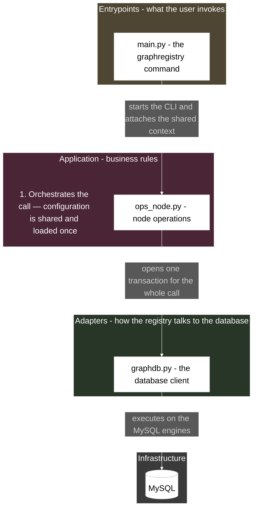

# Sketching

Mermaid house style for architecture "sketches": file/function flow diagrams used in wiki pages such as the GraphRegistry CLI command-flow docs. One box per file with a short role description; arrows carry plain-English phrases describing the interaction; layer subgraphs carry the tuned dark theme and one floating caption each.

**All visual parameters live in `styles.json` in this skill's base directory — the single source of truth. Tuning the style is an edit to that JSON, never to this skill.**

This skill covers flowchart sketches (`layout.mode`). Sequence diagrams have no owner-approved style yet: if one is requested, reuse only the tested `theme` init-directive values and confirm any further styling with the owner before adding it.

## When to use

- Creating a diagram sketch for a wiki page: CLI command flows, architecture overviews.
- Editing or reviewing an existing mermaid sketch for style consistency.

## Renderer constraints (this Outline build)

- `flowchart-elk` (value of `layout.mode`) works and gives clean hierarchical placement.
- `{"defaultRenderer": "elk"}` inside a flowchart init is silently ignored (bundled Mermaid is pre-10.7) — do not use it.
- Init directives honored: `theme`, `themeVariables.background`, `themeVariables.fontSize`.

## Construction rules

Read `styles.json` first and substitute its values wherever a placeholder with a key path appears below.

Structure rules:

1. First line of the mermaid block: the init directive built from `theme`:
   `%%{init: {"theme": "<theme.name>", "themeVariables": {"background": "<theme.background>", "fontSize": "<theme.fontSize>"}}}%%`
2. Diagram type: `<layout.mode> <layout.direction>` (currently `flowchart-elk TD`).
3. One box per file (or coherent artifact), labeled `ID["filename.py - natural-language role"]`. A ` ` inside the label is allowed for two-line titles. The role description tells the reader what the part does in the flow (e.g. `unit_of_work.py - one transaction for the whole call`); keep the filename visible so the reader can find the file.
4. Arrow labels are **narrative** (`labels.style = narrative`): quoted plain-English phrases describing what the interaction does — no function-call syntax, no parameter chains, no `()` soup. The code names (methods, calls) stay in the source files and in the wiki prose/facts, not on the arrows. Example: `NODEOPS -->|"every call opens one unit of work and works on nodes inside it"| UW`. If `labels.style` is ever set to `precise`, use short function-name labels instead (owner tests first).
5. Subgraphs group layers (entrypoints, support/common, application incl. ports, domain, adapters, infrastructure). Give each a short id (ENTRY, EP, APP, DOM, ADPT, INFRA, ...) and a title naming the package path plus its role (e.g. `Entrypoints - what the user invokes`).
6. Subgraph style: fill from the matching `layers.<name>` entry; unmapped groups use `layers.others`; stroke `layers.stroke`; label text `layers.labelColor`. The subgraph id, the layer it groups, and the fill it receives must agree.
7. Edge order is **spine-first** (`structure.spineFirst`): declare the main vertical path (entrypoint down to the database) before branches so ELK centers it; branches (mappers, ports, secondary ops) hang off afterwards. A `%% comment` may section the spine from the branches (invisible in render, useful in source).
8. Dashed arrows `-.->` express "fulfils the contract" from adapters back to application ports (`structure.portArrowsDashed`).
9. `classDef`, `class`, `style`, and `linkStyle` statements go at the **end** of the mermaid block (all owner-tested diagrams do this — keeps renders and diffs consistent). Every file/function box shares the single `box` class; caption nodes share the `note` class — each group assigned in one `class` statement. Each subgraph gets one `style` statement.

## Captions (`captions.*`)

When `captions.enabled` (currently on), add one floating caption per layer container, placed inside the subgraph just before its `end`. Captions explain the phase and the interactions in plain English:

- Numbered steps follow the pipeline order (`1. Read + map`, `2. Orchestrate`, `3. Persist`, ...); context notes are unnumbered (e.g. `Configuration is shared: ...`).
- Style: `classDef note fill:<captions.fill>,stroke:<captions.stroke>,color:<captions.color>;` — borderless, transparent, white italic-feeling text that reads like a comment, not a file.
- Captions are attached to **no arrows** — they float, so the layouter cannot tangle them into the flow.
- One caption per layer, at most ~2 short lines; balance over completeness. A datastore cylinder box needs no caption.

## Visual rules (values from styles.json)

- Boxes: `classDef box fill:<boxes.fill>,stroke:<boxes.stroke>,color:<boxes.text>;`
- Arrows: `linkStyle default stroke:<arrows.color>,color:<arrows.color>`
- Layer containers: `style <SUBGRAPH-ID> fill:<layers.<name>>,stroke:<layers.stroke>,color:<layers.labelColor>`

## Template

Each subgraph id maps 1:1 to a `layers` entry: EP→`layers.entrypoints`, APP→`layers.application`, ADPT→`layers.adapters`, INFRA→`layers.others`. Keep that consistency in every sketch: the subgraph id, the layer it groups, and the fill it receives must agree. A datastore node uses the cylinder shape: `MYSQL[("MySQL")]` (the datastore id is not a module; DB is the database client module in ADPT). The `CAP_APP` node shows the caption placement: inside the subgraph, just before its `end`, attached to no arrows.

## Worked example

The full worked example in the story style (data command, 19 nodes / 6 subgraphs, narrative arrows + captions) lives in the Outline **Registry** collection: "GraphRegistry CLI command flows - steps, functions & files" (story variant section). The spec note "Sketching house style - spec for the sketching skill" is the fallback reference.

## Safety

- Never invent visual parameters — every colour, font size, and line style comes from `styles.json`.
- Keep the grain coherent: one box per file, short narrative arrow labels.
- Keep diagrams readable: balanced box counts per layer; long details go in the wiki text or page facts, not into boxes.
- Narrative labels must stay accurate to the code — if unsure what an interaction does, read the source before labelling it.
